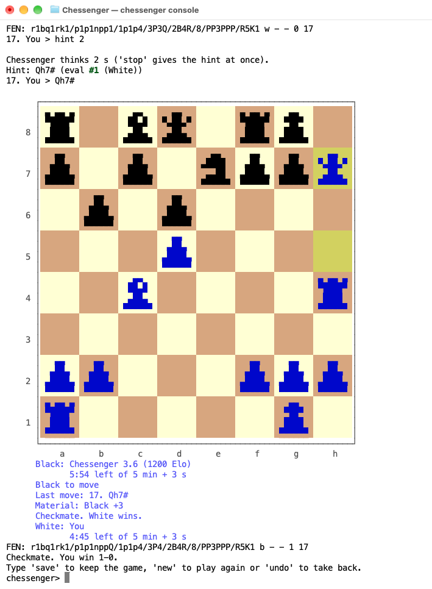
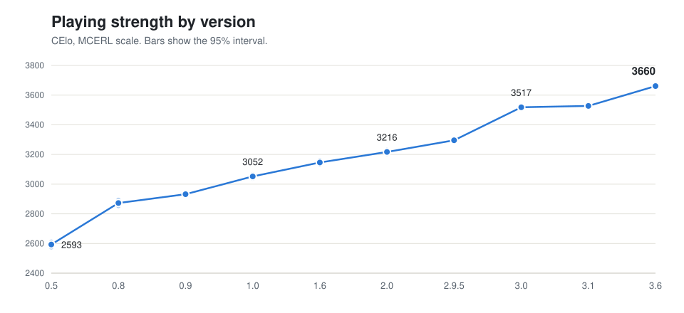
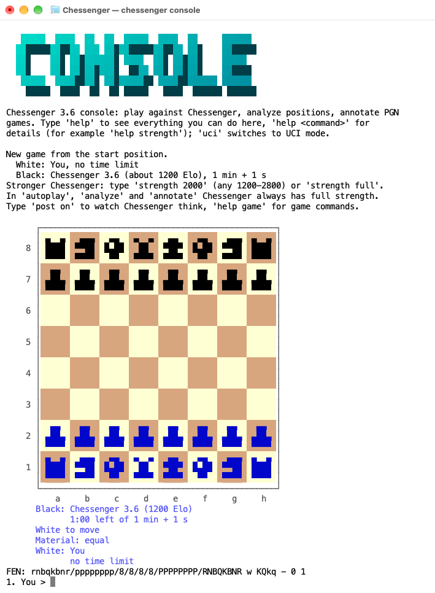
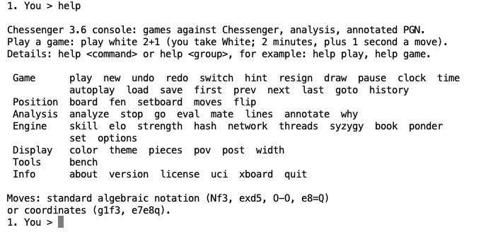
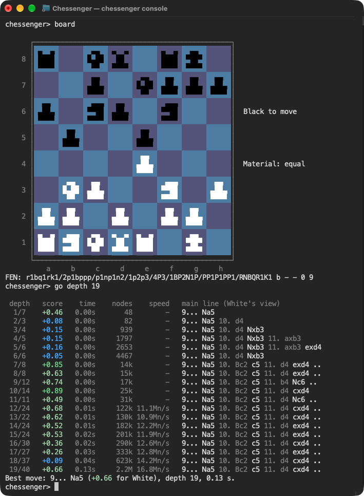

# Chessenger 3.6

Chessenger is a chess engine created from scratch as part of Chessengeria (https://www.chessengeria.eu), following the ideas and chess knowledge
of Dariusz Domagała, in cooperation with Claude Code. It is written in C. Code and data adapted from other projects are named near the end of this file and in `THIRD-PARTY.md`.

Chessenger is a sophisticated, modern and strong chess engine. It runs on many systems and devices, from the newest computers to old ones:
binaries for macOS, Linux and Windows (down to 32-bit Windows PCs with SSE2), and build steps for FreeBSD, OpenBSD and Linux
on RISC-V. It speaks UCI, the older [WinBoard/XBoard](#winboardxboard) protocol, and has a [console mode](#console) for people.

It is a sparring partner for players from beginner to grandmaster: `skill 1` to `skill 9` play at about 1200 to 2800 Elo
(engine scale), `skill 10` at full strength.



- **Version:** 3.6 (code date 2026-11-01)
- **Strength:** 3660 CElo, on the scale of the Mac Chess Engines Rating List (MCERL, https://www.chessengeria.eu/mcerl)
- **Network:** our own, built into the binary (see [Neural network](#neural-network))
- **Download:** eight binaries for macOS, Linux and Windows (see [Download and run](#download-and-run))
- **Build:** macOS, Linux, Windows, FreeBSD, OpenBSD and Linux on RISC-V (see [BUILD.md](BUILD.md))

<picture>
  <source media="(prefers-color-scheme: dark)" srcset="images/strength-dark.svg">
  
</picture>

## Part of Chessengeria

Dariusz Domagała founded and runs Chessengeria (https://www.chessengeria.eu). Chessenger is part of Chessengeria and owes its existence to it:
Chessengeria runs the Mac Chess Engines Rating List (MCERL), where chess engines play hundreds of thousands of games, and that work gave
Chessenger its yardstick and its reason to be built.

## Contents

- [Download and run](#download-and-run)
- [Using Chessenger in a chess GUI (UCI)](#using-chessenger-in-a-chess-gui-uci)
  - [Options and built-in tablebases](OPTIONS.md)
- [WinBoard/XBoard](#winboardxboard)
- [Console](#console)
- [Build from source](#build-from-source)
- [Neural network](#neural-network)
- [How Chessenger is made](#how-chessenger-is-made)
- [License](#license)

## Download and run

This version's GitHub Release carries eight archives; each holds the binary, `LICENSE`, `README.md`, `BUILD.md`, `OPTIONS.md`, `THIRD-PARTY.md` and `LICENSES/`.

| File | For |
|---|---|
| `chessenger-3.6-macos-arm64-pgo.tar.gz` | Mac with Apple Silicon (M1 and newer), macOS 11 or newer (fastest) |
| `chessenger-3.6-macos-x64-avx2.tar.gz` | Mac with Intel CPU with AVX2, macOS 10.9 or newer |
| `chessenger-3.6-linux-arm64-pgo.tar.gz` | Linux, ARM64 (static) (fastest) |
| `chessenger-3.6-linux-x64-avx2-pgo.tar.gz` | Linux, x86-64 with AVX2 (static) (fastest) |
| `chessenger-3.6-windows-x64-avx2.zip` | Windows, most PCs from 2013 on (AVX2); the build rating lists usually use |
| `chessenger-3.6-windows-x64-bmi2.zip` | Windows, Intel Haswell and newer, AMD Zen and newer (x86-64-v3) |
| `chessenger-3.6-windows-arm64-pgo.zip` | Windows on ARM (ARM64) (fastest) |
| `chessenger-3.6-windows-x32.zip` | Windows, 32-bit (needs SSE2): old PCs and 32-bit Windows |

### Which file?

- Windows: if unsure, take `avx2`.
- Windows on ARM: take `arm64`.
- CPU without AVX2: on Windows take `x32`; on Linux and macOS build from source (`make`).
- `-pgo` in a file name means the binary was built with profile-guided optimisation (training run on `bench`), the fastest build for that system, with the same nodes as a build without it.

The GitHub Release also gives the first-start steps for macOS, Linux and Windows.

## Using Chessenger in a chess GUI (UCI)

The engine reports itself as `id name Chessenger 3.6`.

- UCI commands: `uci`, `isready`, `ucinewgame`, `position` (`startpos` or `fen`, then `moves`), `setoption`, `go` (`depth`, `wtime`, `btime`, `winc`, `binc`, `movestogo`, `movetime`, `nodes`, `mate`, `infinite`, `ponder`, `searchmoves`), `stop`, `ponderhit` and `quit`.
- `debug` and `register` are accepted and change nothing.
- `xboard` switches to the WinBoard/XBoard protocol (see [WinBoard/XBoard](#winboardxboard)).
- `console` switches to the console mode for people (see [Console](#console)).
- `help` lists `console`, `xboard`, `uci`, `bench`, `version` and `quit`; `version` prints the name, version, build and date.
- For testing: `perft <N>` (N up to 8, also as `go perft <N>`), `divide <N>` (up to 6), `d` (prints the position), `eval`, `nnue` (network evaluation), `hash`, `bench [depth]` (default 15) and `bench levels` (the playing levels).
- From the command line, after the name of the binary file: `bench [depth]`, `version`, `--help` and the words that start the console (see [Console](#console)).

UCI options and the built-in tablebases are on a separate page: [OPTIONS.md](OPTIONS.md).

## WinBoard/XBoard

- Besides UCI, Chessenger speaks the WinBoard/XBoard protocol (version 2).
- Nothing has to be set: a GUI of this kind starts with the command `xboard`, and Chessenger switches to that protocol by itself.
- To `protover 2` it answers with its features, among them the options `MultiPV`, `Skill Level`, `UCI_LimitStrength` and `UCI_Elo`.

## Console

The console is a text mode for people: playing against Chessenger, analysing and annotating games in a terminal, without a
chess GUI. All its messages are in English.

### Starting the console

Put one of these words after the name of the binary file. The examples use the macOS file; on Linux use the Linux file the
same way, and after your own build `./chessenger`:

```
./chessenger-3.6-macos-arm64-pgo console
./chessenger-3.6-macos-arm64-pgo play white 5+3
./chessenger-3.6-macos-arm64-pgo analyze
./chessenger-3.6-macos-arm64-pgo annotate game.pgn 1
```

- `console` opens the console; in a terminal it starts a game at once: you have White and no time limit, Chessenger has 1 min + 1 s and plays at about 1200 Elo (`strength full` for full strength).
- `play [white|black] [T]` starts a game at once. You take White unless you say `black`; T is the time control, for example `5+3` (5 minutes, 3 seconds added a move), `10` or `40/90`.
- `analyze [FEN]` analyses the start position, or the position given as a FEN (in quotes), until you type `stop`.
- `annotate FILE [S]` marks `?!`, `?` and `??` in game 1 of a PGN file, S seconds a move (default 1), and writes the result to `FILE-annotated.pgn`: for `game.pgn`, `game-annotated.pgn`.

On Windows the same words follow the name of the `.exe` file, for example `chessenger-3.6-windows-x64-avx2.exe console`.
`--help` lists the words, with `bench [DEPTH]` and `version`.

Started without a word, the binary is in UCI mode and waits for a chess GUI; in a terminal it shows its banner and
`Type 'help' for commands, 'console' for the interactive mode.` There `help` lists `console`, `xboard`, `uci`, `bench`, `version` and `quit`,
and `console` opens the console.

On Windows, unpack the archive outside Program Files: `save` writes the game file to the folder Chessenger was started from, and there a normal user may not write.

### Screenshots

`help` shows all commands, by group. The screenshots are from Terminal on macOS.





The console also works in a dark terminal theme:



## Build from source

Build steps for macOS, Linux, Windows, FreeBSD, OpenBSD and Linux on RISC-V are on a separate page: [BUILD.md](BUILD.md).

## Neural network

- The network is our own, trained from scratch with bullet (MIT) on Chessenger's own games and on [Leela Chess Zero training data](https://storage.lczero.org/files/training_data/), which is made available under the [Open Database License (ODbL)](https://opendatacommons.org/licenses/odbl/1-0/).
- We offer, free of charge and in machine-readable form, the alteration file for the Leela Chess Zero training data as defined in section 4.6 b of the ODbL; request it by opening an issue at https://github.com/chessengeriadoteu/chessenger/issues.
- The network architecture and inference code are adapted from Starzix 6.0.
- With the UCI option `Use NNUE` set to `false`, the engine plays with its classic evaluation instead of the network, on one thread.

## How Chessenger is made

The C code is written by AI coding assistants, mostly Anthropic's Claude models (Claude chat in 2025, Claude Code from 2026), with a small part done with OpenAI's GPT models. Dariusz Domagała decides what to try, sets the test conditions and decides what is released, and he is responsible for everything published here. Code adapted from other engines is listed near the end of this file and in THIRD-PARTY.md, and the data behind the network in Neural network and THIRD-PARTY.md.

## Thanks

Chessenger contains code adapted from these engines:

- OliThink 5.10.5 (Oliver Brausch, MIT)
- Stash 37 (Morgan Houppin, GPL-3.0-or-later)
- Starzix 6.0 (zzzzz, WTFPL)
- Stockfish (the Stockfish developers, GPL-3.0-or-later)
- SimpleChess 3.5.0 (Sam Moore, GPL-3.0-only)
- Fathom (Ronald de Man, basil00 and Jon Dart, MIT)

It also uses:

- evaluation weights from 4ku (kz04px)
- piece-square tables from PeSTO (Ronald Friederich) and the Simplified Evaluation Function (Tomasz Michniewski)
- the bullet trainer (Jamie Whiting)
- the Chess Programming Wiki

## License

- GPL-3.0-or-later, see `LICENSE`.
- Code adapted from SimpleChess 3.5.0, in `main.c` and `levels/lvl_driver.c`, is under GPL-3.0-only (version 3 only), so these files and the binaries built from them are distributed under GPL version 3 only.

Third-party code and data in this release are listed in `THIRD-PARTY.md`, each with its license where one exists.

Chessenger is free software: you can redistribute it and/or modify it under the terms of the GNU General Public
License as published by the Free Software Foundation, either version 3 of the License, or (at your option) any
later version. Chessenger is distributed in the hope that it will be useful, but WITHOUT ANY WARRANTY; without even the
implied warranty of MERCHANTABILITY or FITNESS FOR A PARTICULAR PURPOSE. See the GNU General Public License for
more details.
